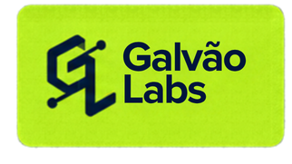

<strong>Ideias que viram impacto.</strong> 
TECNOLOGIA · INOVAÇÃO · DESENVOLVIMENTO

<a href="https://github.com/orgs/GalvaoLabs/repositories">Explorar projetos →</a>

---

## Sobre a Galvão Labs

A **Galvão Labs** é uma empresa de tecnologia e inovação que desenvolve soluções digitais. Exploramos software, inteligência artificial e tecnologias emergentes para transformar ideias em ferramentas e produtos úteis, com propósito e foco em impacto.

## Áreas de atuação

- **Desenvolvimento de software** — aplicações, sistemas e ferramentas digitais.
- **Inteligência artificial e automação** — exploração e desenvolvimento de soluções que ampliam capacidades e simplificam processos.
- **Produtos digitais** — concepção de plataformas, ferramentas e experiências digitais.
- **Pesquisa e prototipagem** — experimentação tecnológica e validação de novas ideias.

## Como trabalhamos

Buscamos clareza antes da complexidade, usamos protótipos para aprender e evoluímos as soluções a partir dos problemas que queremos resolver.

## Projetos

Conheça nossas iniciativas e acompanhe o que estamos construindo nos [repositórios públicos da Galvão Labs](https://github.com/orgs/GalvaoLabs/repositories).

---

## English

**Galvão Labs** is a technology and innovation company building digital solutions with software, artificial intelligence, and emerging technologies.

### What we do

- **Software development** — applications, systems, and digital tools.
- **Artificial intelligence and automation** — solutions that extend capabilities and simplify processes.
- **Digital products** — platforms, tools, and digital experiences.
- **Research and prototyping** — technology experimentation and idea validation.

We value clarity, purposeful experimentation, and continuous improvement to turn ideas into useful solutions with real impact.

BRASIL · BRAZIL

