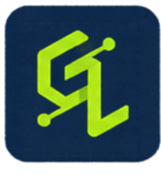

 

### IDEIAS QUE VIRAM IMPACTO.

**Ideas that create impact.**

 

TECNOLOGIA · INOVAÇÃO · DESENVOLVIMENTO

  

---

## 01 — SOBRE NÓS
### ABOUT US

A **Galvão Labs** é uma empresa de tecnologia e inovação dedicada ao desenvolvimento de soluções digitais, explorando o potencial do software, da inteligência artificial e de novas tecnologias.

Nosso propósito é transformar ideias em soluções que gerem valor, resolvam problemas e produzam impacto.

---

**ENGLISH**

**Galvão Labs** is a technology and innovation company focused on developing digital solutions through software, artificial intelligence and emerging technologies.

Our purpose is to turn ideas into solutions that create value, solve problems and generate impact.

---

## 02 — O QUE FAZEMOS
### WHAT WE DO

<table>
<tr>
<td width="50%" valign="top">

<h3>◈ Desenvolvimento de Software</h3>

Aplicações, sistemas e ferramentas digitais desenvolvidos para solucionar problemas.

SOFTWARE DEVELOPMENT

</td>
<td width="50%" valign="top">

<h3>◈ Inteligência Artificial</h3>

Exploração e desenvolvimento de soluções com inteligência artificial e automação.

ARTIFICIAL INTELLIGENCE

</td>
</tr>
<tr>
<td width="50%" valign="top">

<h3>◈ Produtos Digitais</h3>

Concepção e desenvolvimento de plataformas, ferramentas e experiências digitais.

DIGITAL PRODUCTS

</td>
<td width="50%" valign="top">

<h3>◈ Pesquisa e Experimentação</h3>

Prototipagem, experimentação tecnológica e desenvolvimento de novas ideias.

RESEARCH & EXPERIMENTATION

</td>
</tr>
</table>

---

## 03 — NOSSA ABORDAGEM
### OUR APPROACH

| Pilar | Direcionamento |
|:---|:---|
| Inovação | Explorar novas possibilidades tecnológicas |
| Desenvolvimento | Construir soluções funcionais |
| Propósito | Desenvolver com objetivos claros |
| Evolução | Aprender, experimentar e aprimorar |
| Impacto | Transformar ideias em valor real |

---

## 04 — TECNOLOGIA
### TECHNOLOGY

 

---

## 05 — PROJETOS
### OUR PROJECTS

Conheça nossas iniciativas, experimentos e soluções em desenvolvimento.

Explore nosso trabalho e acompanhe nossa evolução.

 

---

# GALVÃO LABS

### Ideias que viram impacto.

TECHNOLOGY · INNOVATION · DIGITAL SOLUTIONS

  

BRASIL · BRAZIL

